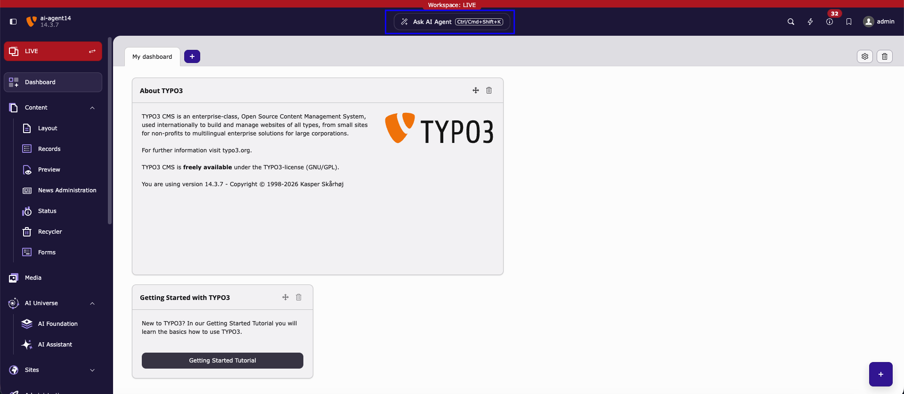

.. include:: ../Includes.txt

.. _ask-ai-agent:

============
Ask AI agent
============

The **AI agent** is a helper inside the TYPO3 backend. It works on the
**page you are editing**: you describe a task in plain language, the AI agent
reads that page and its content, and it prepares the change for you. You
review the change and decide whether it is saved.

You open it with the :guilabel:`Ask AI Agent` button in the backend top bar.

   The :guilabel:`Ask AI Agent` button in the center of the backend top bar
   (highlighted). Click it, or press :kbd:`Ctrl/Cmd+Shift+K`, to open the
   AI agent.

.. _ask-ai-agent-quick-start:

Get started in three steps
==========================

.. rst-class:: bignums

#. **Select the page first**

   Open :guilabel:`Content > Layout` (or another page module) and click the
   page you want to work on in the page tree. The AI agent uses this page as
   its context.

#. **Click Ask AI Agent**

   Click :guilabel:`Ask AI Agent` in the top bar, or press
   :kbd:`Ctrl/Cmd+Shift+K`. The AI agent window opens and shows the selected
   page in its context line.

#. **Ask, review, apply**

   Type what you need, for example *"Summarize the content of this page"*,
   and press :kbd:`Enter`. When the AI agent proposes a change, read the
   change card and click :guilabel:`Apply` to save it, or cancel it.

.. important::

   *  **Nothing is saved until you click** :guilabel:`Apply`.
   *  An applied change is saved in the **selected workspace**: in
      :guilabel:`Live` it is public immediately; in a draft workspace it
      stays in that workspace until it is published.
   *  The AI agent has **your** backend permissions — never more.

.. tip::

   New to the AI agent? Continue with :ref:`ask-ai-agent-where`. It shows,
   with screenshots, where the AI agent opens and what each part of its
   window does.

.. _ask-ai-agent-pages:

All topics
==========

Read the pages in this order:

.. list-table::
   :header-rows: 1
   :widths: 35 65

   *  - Page
      - What you learn
   *  - :ref:`ask-ai-agent-where`
      - Where to find the AI agent in the backend, and what each part of its
        window does.
   *  - :ref:`ask-ai-agent-at-a-glance`
      - The whole workflow and the key warnings on one screen.
   *  - :ref:`ask-ai-agent-how`
      - How the page context is used, and the four steps of every request.
   *  - :ref:`ask-ai-agent-before`
      - Requirements: AI provider, access, permissions.
   *  - :ref:`ask-ai-agent-steps`
      - Open the AI agent on a page, ask, read the answer, apply or cancel a
        change.
   *  - :ref:`ask-ai-agent-examples`
      - Ready-to-use requests with AI Foundation tools.
   *  - :ref:`ask-ai-agent-shortcuts`
      - Keyboard shortcuts and how to change them.
   *  - :ref:`ask-ai-agent-conversations`
      - Start, switch, rename, and delete conversations.
   *  - :ref:`ask-ai-agent-tabs`
      - The five tabs of :guilabel:`AI Foundation > AI Agent`.
   *  - :ref:`ask-ai-agent-feature-settings`
      - Administrators: limits, conversation retention, and conversation
        list settings in :guilabel:`AI Foundation > AI Features > AI Agent`.
   *  - :ref:`ask-ai-agent-troubleshooting`
      - Common messages and how to solve them.

.. toctree::
   :hidden:
   :maxdepth: 2
   :titlesonly:

   WhereOpens
   AtAGlance
   HowItWorks
   BeforeYouStart
   StepByStep
   ExampleRequests
   KeyboardShortcuts
   Conversations
   AiAgentModule
   FeatureSettings
   Troubleshooting
   ../Agent/Index

.. _ask-ai-agent-related:

Related
=======

*  :ref:`MCP Server <mcp-server>` — connect external AI clients such as Cursor
   or Claude Desktop to TYPO3.
*  :ref:`AI Providers <ai-providers>` — configure providers and models with
   tool calling.
