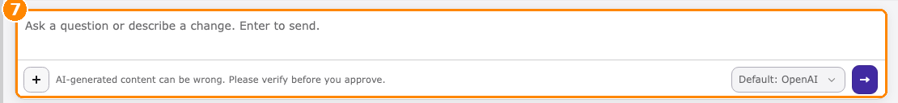
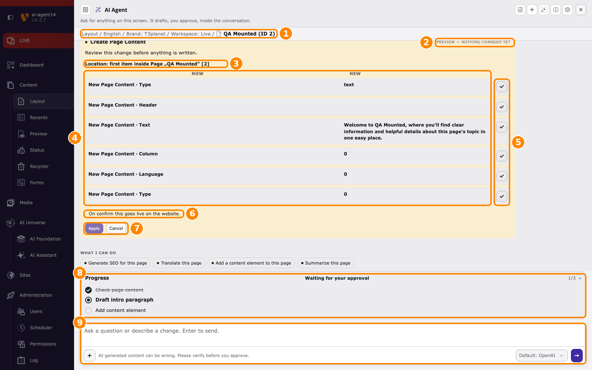

.. include:: ../Includes.txt

.. _ask-ai-agent-steps:

=============================
Use the AI agent step by step
=============================

.. contents:: On this page
   :local:
   :depth: 1

Step 1: Open the AI agent on your page
======================================

The AI agent works on the page you are editing. Select the page first.

#. Go to :guilabel:`Content > Layout` and select the page you want to work on
   in the page tree.
#. Click :guilabel:`Ask AI Agent` in the top bar, or press
   :kbd:`Ctrl/Cmd+Shift+K`. The AI agent window opens on top of the page.
#. On first use, read the AI disclosure notice and click :guilabel:`Got it`.
#. Check the **context line** below the title. It shows the page the AI agent
   works on. Requests and changes apply to this page.

.. important::

   If the context line shows the wrong page, close the AI agent, select the
   right page in the page tree, and open the AI agent again.

Step 2: Ask a question
======================

#. Click into the message field at the bottom of the window.
#. Type a short request in your own words, for example:

   .. code-block:: text

      Show me the details of this page.

#. **Optional:** in a new conversation, choose the AI provider in the
   dropdown below the message field. :guilabel:`Default: …` uses the default
   provider. After the first answer, the provider is fixed for this
   conversation.
#. Press :kbd:`Enter` or click the send button.

   The message field with the AI provider dropdown next to the send button.

.. tip::

   Start with a question that only reads data. It is the safest way to learn
   how the AI agent works.

Step 3: Read the answer
=======================

#. Wait until the answer is complete. Each tool the AI agent runs is shown as
   a step marked :guilabel:`completed`.
#. For tasks with several steps, follow the :guilabel:`Progress` list. A step
   that changes data waits for your approval.
#. If the AI agent asks a follow-up question (``ask_clarification``), answer
   it in the message field. The AI agent asks instead of guessing.

Step 4: Apply or cancel a change
================================

When your request requires a change, the AI agent prepares a **change card**
instead of writing data.

   A change card waiting for approval. The numbers match the steps below.

#. Check the **context line** (1). It shows the page the change applies to.
#. Check the **preview badge** (2). :guilabel:`Preview — nothing changed yet`
   confirms that nothing has been written.
#. Check the **location** (3): where the record will be created or changed.
#. Compare each field (4): :guilabel:`Now` is the current value,
   :guilabel:`New` is the proposed value.
#. Use the **check button** (5) next to a field to include it or leave it out.
#. Read the **hint** (6) at the bottom of the card. It tells you where the
   change is saved. In the Live workspace it reads
   :guilabel:`On confirm this goes live on the website.`
#. Click :guilabel:`Apply` (7) to write the change, or :guilabel:`Cancel` to
   discard it. After :guilabel:`Cancel`, nothing is written.
#. The :guilabel:`Progress` list (8) shows :guilabel:`Waiting for your
   approval` and continues with the next step after your decision.
#. To change the request instead, type in the **message field** (9).

After :guilabel:`Apply`, the card shows :guilabel:`Changes applied` (see
number 5 in the screenshot under :ref:`ask-ai-agent-how`). To revert the
change, click :guilabel:`Undo`.

.. warning::

   An applied change is saved in the **selected workspace**. In
   :guilabel:`Live` it is public immediately. In a draft workspace it stays in
   that workspace until it is published. To review changes before they go
   live, switch to a draft workspace first.

.. attention::

   **Deleting needs two clicks.** The card is shown in red and states that the
   action cannot be undone. The first click (:guilabel:`Confirm (1 of 2)`)
   only arms the action; the second click (:guilabel:`Apply (2 of 2)`) runs
   it. :guilabel:`Undo` restores changed values, but it **cannot** restore
   deleted items.
