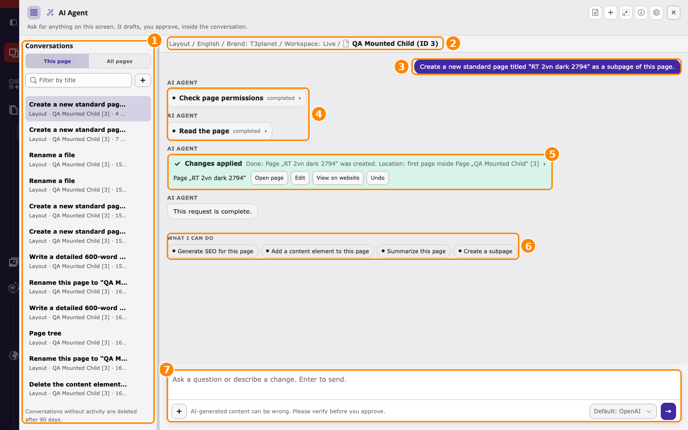
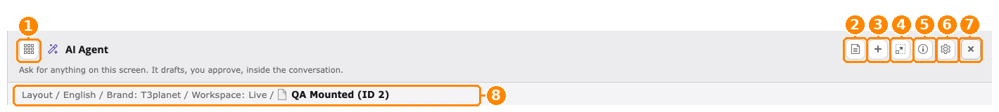
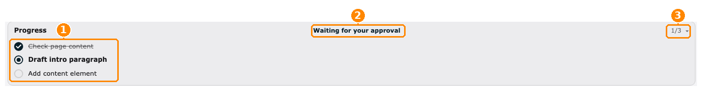
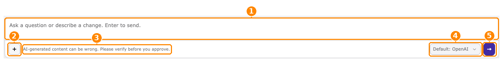

.. include:: ../Includes.txt

.. _ask-ai-agent-where:

========================
Where the AI agent opens
========================

.. contents:: On this page
   :local:
   :depth: 1

The AI agent opens on the page you are editing. This page shows where to find it
in the TYPO3 backend, what each part of the window does, and where you manage it.

.. _ask-ai-agent-where-screens:

Where to find it in the backend
===============================

Select a tab to see each place in the TYPO3 backend. The numbers match the
orange markers in the screenshots.

.. tabs::

   .. tab:: 1. Full backend view

      .. figure:: ../Images/ask-ai-agent-be-where.png
         :alt: TYPO3 backend showing AI Foundation > AI Agent > Overview with the Ask AI Agent button, the AI Foundation module, the AI Agent module tab, its five tabs, the tool counters and the keyboard shortcut setting marked 1 to 6
         :class: with-border with-shadow

         :guilabel:`AI Foundation > AI Agent > Overview` with all entry points
         marked (1–6).

      #. :guilabel:`Ask AI Agent` in the top bar.
      #. :guilabel:`AI Universe > AI Foundation` in the module menu.
      #. The :guilabel:`AI Agent` module tab.
      #. Its five tabs.
      #. Tool counters.
      #. :guilabel:`Keyboard shortcut`.

   .. tab:: 2. Ask AI Agent

      .. figure:: ../Images/ask-ai-agent-be-where-topbar.png
         :alt: Backend top bar with the Ask AI Agent button and the keyboard shortcut Ctrl/Cmd+Shift+K marked 1
         :class: with-border with-shadow

         Marker 1: :guilabel:`Ask AI Agent` in the backend top bar.

      *  Opens the AI agent for the page you are editing.
      *  The button shows the active keyboard shortcut, by default
         :kbd:`Ctrl/Cmd+Shift+K`.
      *  The red bar above it shows the current workspace. An applied
         change is saved in the **selected workspace**: in
         :guilabel:`Workspace: LIVE` it is public immediately; in a draft
         workspace it stays in that workspace until it is published.

   .. tab:: 3. AI Foundation module

      .. figure:: ../Images/ask-ai-agent-be-where-module-menu.png
         :alt: Backend module menu with AI Foundation marked 2 below AI Universe
         :class: with-border with-shadow

         Marker 2: :guilabel:`AI Universe > AI Foundation` in the module
         menu.

      Open this module to manage AI Foundation: providers, permissions, and
      the AI agent.

   .. tab:: 4. AI Agent module tab

      .. figure:: ../Images/ask-ai-agent-be-where-module-tabs.png
         :alt: AI Foundation module navigation with the AI Agent tab marked 3 and its five tabs Overview, Severity policy, Governance, Audit and Demand signals marked 4
         :class: with-border with-shadow

         Marker 3: the :guilabel:`AI Agent` module tab. Marker 4: its five
         tabs.

      *  :guilabel:`Overview` — status, tools, and keyboard shortcut.
      *  :guilabel:`Severity policy`, :guilabel:`Governance`,
         :guilabel:`Audit`, :guilabel:`Demand signals` — see
         :ref:`ask-ai-agent-tabs`.

   .. tab:: 5. Status and shortcut

      .. figure:: ../Images/ask-ai-agent-be-where-status.png
         :alt: Overview tab with the tool counters marked 5 and the Keyboard shortcut setting marked 6
         :class: with-border with-shadow

         Marker 5: tool counters. Marker 6: :guilabel:`Keyboard shortcut`.

      *  **Tool counters** show how many tools are registered, how many you
         can run now, and how many are locked.
      *  **Keyboard shortcut** sets how the AI agent opens in this browser.
         :kbd:`Ctrl/Cmd+Shift+K` is recommended because it keeps
         :kbd:`Ctrl/Cmd+K` for TYPO3 Live Search.

.. _ask-ai-agent-where-overview:

Overview
========

This page shows **where you open the AI agent** in the TYPO3 backend, **what
each part of the AI agent window does**, and **where you manage it**. After
reading it, you know:

*  how to open the AI agent on the page you are editing,
*  what the icons, the context line, the progress list, and the message field
   of the window do,
*  where to choose the AI provider for a conversation,
*  where its settings and status are:
   :guilabel:`AI Foundation > AI Agent`.

The AI agent is an assistant for **the page you are working on**. You open
it while you edit a page; it opens as a window on top of the page, so you
never leave your work. The page, its site, language, and workspace are shown
in the **context line** of the window. The AI agent uses this page as its
context, and every change it prepares applies to this page.

.. note::

   The AI agent is not a general chat for every backend module. Select the
   page first, then open the AI agent.

.. important::

   *  **Select the page first:** open the page in the page tree, for example
      in :guilabel:`Content > Layout`.
   *  **Open the AI agent:** click :guilabel:`Ask AI Agent` in the backend top
      bar, or press :kbd:`Ctrl+Shift+K` (Windows, Linux) /
      :kbd:`Cmd+Shift+K` (macOS).
   *  **Check the context line:** it must show the page you want to change.
   *  **Choose the AI provider:** use the provider dropdown below the message
      field, for example :guilabel:`Default: mistral`, **before you send the
      first message**.
   *  **Nothing is saved until you click** :guilabel:`Apply`.
   *  **Settings and status:** :guilabel:`AI Foundation > AI Agent`.

Open the AI agent in three steps
================================

#. Open the page you want to work on: go to :guilabel:`Content > Layout`
   and select the page in the page tree.
#. Click :guilabel:`Ask AI Agent` in the top bar, or press
   :kbd:`Ctrl/Cmd+Shift+K`.
#. The AI agent window opens on top of the page. Check that the context line
   shows the right page, then type your request in the message field at the
   bottom and press :kbd:`Enter`.

To see the settings and status of the AI agent, open
:guilabel:`AI Universe > AI Foundation` in the module menu and select the
:guilabel:`AI Agent` module tab.

.. _ask-ai-agent-where-window:

The AI agent window, part by part
=================================

The screenshots in this section are taken from a TYPO3 v14 backend with
AI Foundation installed. The **orange numbers** in each screenshot match the
numbered list below it.

The whole window
----------------

   The AI agent window on the page "QA Mounted Child", after a request was
   applied.

#. **Conversations** — your earlier conversations. :guilabel:`This page`
   lists the conversations about the current page, :guilabel:`All pages`
   lists all of them. Use :guilabel:`Filter by title` to find one, and
   :guilabel:`+` to start a new one.
#. **Context line** — the page the AI agent works on (see
   :ref:`ask-ai-agent-where-context`).
#. **Your request** — the message you sent, shown on the right.
#. **Steps** — what the AI agent did to answer, for example
   :guilabel:`Read the page`. Click a step to see its details.
#. **Result card** — the outcome. After a change is applied, it shows
   :guilabel:`Changes applied` with the buttons :guilabel:`Open page`,
   :guilabel:`Edit`, :guilabel:`View on website`, and :guilabel:`Undo`.
#. **What I can do** — suggested next requests for this page, for example
   :guilabel:`Summarize this page` or :guilabel:`Create a subpage`. Click a
   suggestion to send it.
#. **Message field** — type your next request (see
   :ref:`ask-ai-agent-where-composer`).

.. _ask-ai-agent-where-header:

Header icons
------------

   The header of the AI agent window and the context line below it.

#. **Show conversations** — shows or hides the list of conversations on the
   left.
#. **Summarize conversation** — writes a short summary of a long
   conversation, so you can continue with less history. The icon appears
   after a few messages.
#. **New conversation** — starts an empty conversation. Use it for a new
   task, or to change the AI provider.
#. **Full screen** — enlarges the window to the full backend area. Click
   again to return.
#. **How the AI Agent works** — opens a short help panel with the rules of
   the AI agent and the AI provider in use.
#. **Settings** — opens :guilabel:`AI Foundation > AI Agent`. Only shown to
   users who may open these settings.
#. **Close** — closes the window. The conversation is kept; open the AI
   agent again to continue.
#. **Context line** — see below.

Below the title, the line *Ask for anything on this screen. It drafts, you
approve, inside the conversation.* summarizes the principle: the AI agent
prepares a change, and you decide whether it is applied.

.. _ask-ai-agent-where-context:

Context line
------------

The context line (marker 8 above) shows **what the AI agent works on**, from
left to right:

*  the backend module, for example :guilabel:`Layout`,
*  the language, for example :guilabel:`English`,
*  the brand profile from :guilabel:`AI Foundation > AI Context`, for example
   :guilabel:`Brand: T3planet`,
*  the workspace, for example :guilabel:`Workspace: Live`,
*  the page and its ID, for example :guilabel:`QA Mounted (ID 2)`.

.. warning::

   Always check the context line before you send a request. The AI agent
   works on this page and site unless you name something else. An applied
   change is saved in the **selected workspace**: in :guilabel:`Workspace: Live`
   it is public immediately; in a draft workspace it stays in that workspace
   until it is published.

.. _ask-ai-agent-where-progress:

Progress
--------

   The :guilabel:`Progress` list above the message field.

For a request with several steps, the AI agent shows its plan in
:guilabel:`Progress`, directly above the message field.

#. **Steps** — the planned steps. A crossed-out step is done, the bold step
   is the current one, the grey steps are next.
#. **Status** — what the AI agent is doing now. :guilabel:`Waiting for your
   approval` means a change is ready; review it in the conversation and
   click :guilabel:`Apply` or :guilabel:`Cancel`.
#. **Step counter** — the current step and the total, for example
   :guilabel:`1/3`. Click the arrow to collapse or expand the list.

.. _ask-ai-agent-where-composer:

Message field, AI provider, and send
------------------------------------

   The message field at the bottom of the AI agent window. In this
   screenshot the AI provider dropdown shows :guilabel:`Default: OpenAI`.

#. **Message field** — type your request, for example *Add a text element
   with a short introduction to this page*. Press :kbd:`Enter` to send,
   :kbd:`Shift+Enter` for a new line.
#. **Attach (+)** — :guilabel:`Add files or photos` attaches an image or
   document to your request. :guilabel:`Actions` lists the actions you can
   ask for.
#. **Hint** — *AI-generated content can be wrong. Please verify before you
   approve.* Always review a change before you click :guilabel:`Apply`.
#. **AI provider dropdown** — below the message field, next to the send
   button. It selects the AI provider that answers in this conversation.
   :guilabel:`Default: …` uses the default provider of the site, for example
   :guilabel:`Default: mistral` or :guilabel:`Default: OpenAI`. See
   :ref:`ask-ai-agent-where-provider`.
#. **Send** — sends the request. While the AI agent works, a
   :guilabel:`Stop` button is shown instead.

.. _ask-ai-agent-where-provider:

Change the AI provider
======================

The AI provider answers your request. You select it in the **dropdown below
the message field** of the AI agent window, next to the send button.

#. Open the AI agent on your page and click **New conversation** (:guilabel:`+`
   in the header).
#. Open the dropdown next to the send button. It shows the default provider,
   for example :guilabel:`Default: mistral`.
#. Select the provider you want to use.
#. Type your request and send it.

.. note::

   *  **The provider is fixed per conversation.** After the first answer, the
      dropdown is locked. To use another provider, start a new conversation.
   *  The dropdown is shown only when more than one provider is available.
      Add providers in :guilabel:`AI Foundation > AI Providers`.
   *  Use a provider that supports **tool calling**. See
      :ref:`ask-ai-agent-before`.

Where to find what
==================

.. list-table::
   :header-rows: 1
   :widths: 30 70

   *  - What
      - Where
   *  - **Open the AI agent**
      - Select the page you are editing, then backend top bar >
        :guilabel:`Ask AI Agent`, or press
        :kbd:`Ctrl+Shift+K` (Windows, Linux) / :kbd:`Cmd+Shift+K` (macOS).
   *  - **Check which page is used**
      - AI agent window > context line below the title.
   *  - **Choose the AI provider**
      - AI agent window > dropdown below the message field, before the first
        message of a conversation.
   *  - **Start over / switch provider**
      - AI agent window > header > :guilabel:`+` (New conversation).
   *  - **Status and tools**
      - :guilabel:`AI Foundation > AI Agent > Overview`
   *  - **Settings (limits, conversations)**
      - :guilabel:`AI Foundation > AI Features` > :guilabel:`AI Agent` card >
        :guilabel:`Configure`. See :ref:`ask-ai-agent-feature-settings`.
   *  - **Who may use it**
      - Backend user group > :guilabel:`Access Lists > Custom module options >
        AI Foundation capabilities` > :guilabel:`AI Agent access`
   *  - **Restrict tools per group**
      - :guilabel:`AI Foundation > AI Permissions` > :guilabel:`Limits` >
        :guilabel:`AI Agent tools`

.. note::

   If :guilabel:`Ask AI Agent` is not shown in your top bar, your backend user
   group does not have :guilabel:`AI Agent access`. Ask your administrator.

Next steps
==========

*  :ref:`ask-ai-agent-how` — the four steps of every request.
*  :ref:`ask-ai-agent-before` — requirements before the first use.
*  :ref:`ask-ai-agent-steps` — open the AI agent on a page, ask, and apply a
   change step by step.
*  :ref:`ask-ai-agent-shortcuts` — change the keyboard shortcut.
*  :ref:`ask-ai-agent-tabs` — the five tabs of the AI Agent module.
*  :ref:`ask-ai-agent-feature-settings` — limits, retention, and conversation
   settings (administrators).
