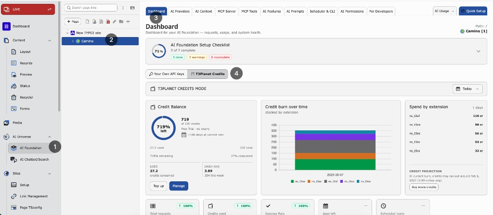
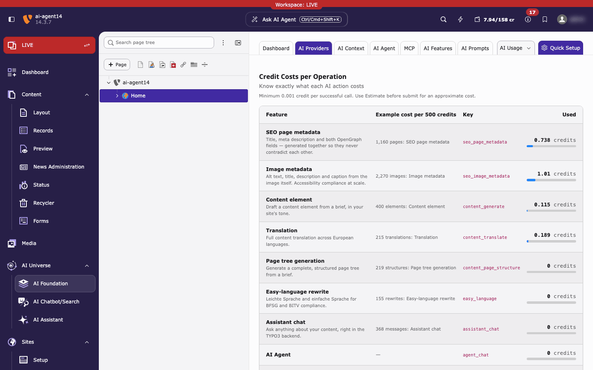
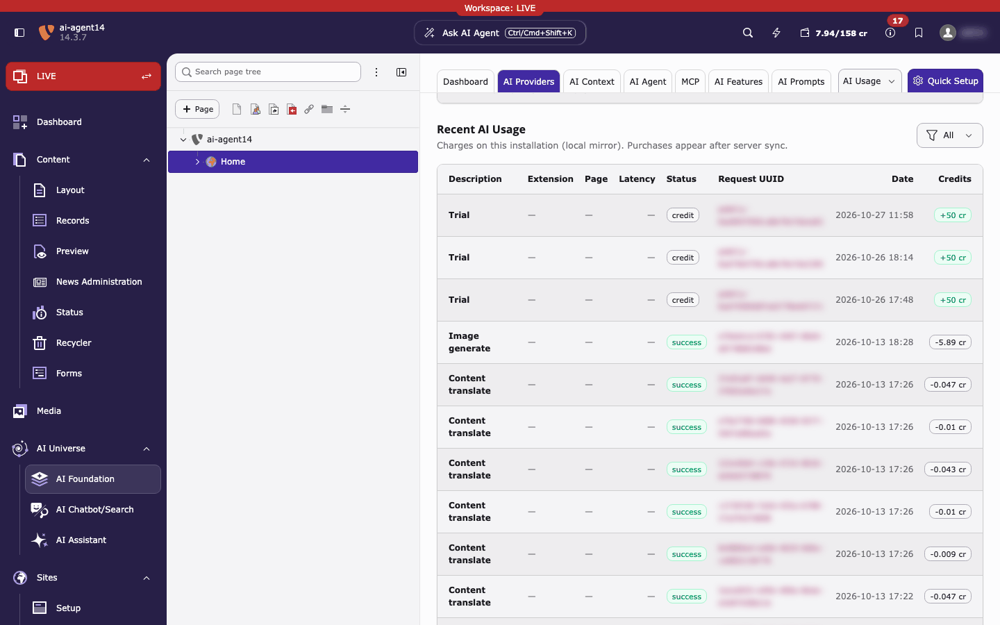

.. include:: ../../Includes.txt

.. _t3planet-credits-dashboard:
.. _t3planet-credits-ai-usage:

====================
Dashboard & AI Usage
====================

Monitor credit balance on the Dashboard and verify Credits traffic in AI Usage.

Dashboard
=========

**Path:** :guilabel:`AI Foundation > Dashboard`

Use the switch at the top of the Dashboard to look at :guilabel:`Own API Keys`
or :guilabel:`T3Planet Credits`. The credits view shows the numbers below.
The banner above the cards reads :guilabel:`T3PLANET CREDITS MODE` and has the
period filter on its right. The :guilabel:`Credit Balance` card on the Dashboard
has the buttons :guilabel:`Top up` and :guilabel:`Manage`. Both open
:guilabel:`AI Foundation > AI Providers`, where you buy credits and see the
details.

   Credits Dashboard — remaining balance, credit burn over time, spend by
   extension, and period KPIs.

What it shows
-------------

* **Credit balance** — remaining credits from T3Planet
* **Usage charts** — credit use and requests for the selected period
* **KPI cards** — requests, tokens, credits used, success rate
* **Recent requests** — the latest AI requests from the local request log
  for the current period filter (not a fixed “last hour” window). See
  :ref:`AI Usage <t3planet-credits-ai-usage-section>` below for the full
  filterable history.

.. tip::

   Remaining balance comes from T3Planet. Local charts and recent requests come
   from the request log. They are related, but not always identical.

Period filter
-------------

Use Today, Yesterday, 7 / 14 / 30 days, or a custom range. Charts, KPIs, and
the recent-requests list follow this filter.

Credits panel on AI Providers
-----------------------------

**Path:** :guilabel:`AI Foundation > AI Providers` (Credits active)

This page has the most detail about your credits:

* :guilabel:`Credit Balance` — credits left and :guilabel:`Buy more credits`
* **Credits used**, **Daily average** and **Est. remaining days** — a quick
  forecast based on your recent use
* :guilabel:`AI Credit Bundles` — plans and top-ups, see
  :ref:`Buy credits <t3planet-credits-buy>`
* :guilabel:`Credit Costs per Operation` — what each AI action costs, so there
  are no surprises
* :guilabel:`Recent AI Usage` — charges on this site. Filter by
  :guilabel:`Entry type` (:guilabel:`All`, :guilabel:`Debit`,
  :guilabel:`Credit`). Purchases appear after the next sync with T3Planet.

   :guilabel:`Credit Costs per Operation`: each AI feature with an example of
   how many actions 500 credits cover, and the credits used so far.

   :guilabel:`Recent AI Usage`. Request IDs are blurred in this screenshot.

**What you should see in Recent AI Usage:** one row per entry with
:guilabel:`Description`, :guilabel:`Extension`, :guilabel:`Page`,
:guilabel:`Latency`, :guilabel:`Status`, :guilabel:`Request UUID`,
:guilabel:`Date` and :guilabel:`Credits`. Credits you receive (for example the
free trial) show as :guilabel:`credit` with a green *+50 cr*. AI calls show as
:guilabel:`success` with a negative amount such as *-0.047 cr*.

The top bar of the TYPO3 backend also shows a credit counter (used / total,
for example *7.94/158 cr*).

.. note::

   The :guilabel:`Recent AI Usage` list is a copy kept on this installation. If
   you connect a different credits account with a claim code, the copy is
   cleared and fills again from the new account.

.. _t3planet-credits-ai-usage-section:

AI Usage
========

**Path:** :guilabel:`AI Foundation > AI Usage`

Use AI Usage to confirm that AI calls ran through T3Planet Credits and to
inspect individual requests.

What to look for
----------------

For Credits traffic, the **provider** value is:

``t3planet_credits``

Column glossary
---------------

* **Module / extension** — which product triggered the call (for example
  T3 AI, AI Search, AI Chatbot)
* **Model** — model used for that request
* **Tokens** — input and output token count
* **Credits** — credits charged for a successful Credits request
* **Status** — success or error for that call
* **Provider** — ``t3planet_credits`` when Credits handled the request;
  otherwise your own API provider id

Filter and search
-----------------

In :guilabel:`AI Usage`, narrow the log by:

* **Date range** — same period idea as the Dashboard (today, last N days,
  or custom)
* **Provider** — filter to ``t3planet_credits`` to see only Credits traffic
* **Status** — success vs failed/error rows
* **Module / extension** — when you need traffic from one product only

Use these filters when the recent list on the Dashboard is not enough.

How to verify Credits
---------------------

1. Activate Credits.
2. Run one AI action that uses AI Foundation — for example, generate a meta
   description in **T3 AI**.
3. Open :guilabel:`AI Usage`.
4. Filter by provider ``t3planet_credits`` (or scan the latest rows).
5. Confirm a new row for that action.

From Dashboard, open a recent request or go to :guilabel:`AI Usage` when you
need filters, older history, or failed-request details.
