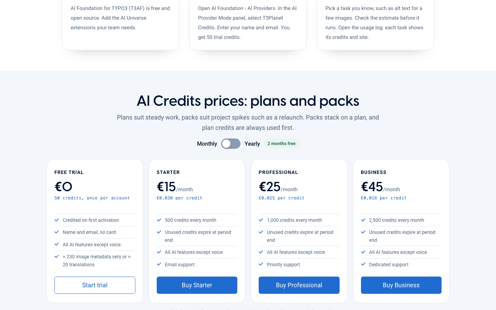

.. include:: ../../Includes.txt

.. _t3planet-credits-buy:

===========
Buy credits
===========

**AI Credits** are the balance that pays for AI tasks in TYPO3. Examples are
translations, image descriptions and page metadata. One balance works for all
AI features.

.. important::

   **You can buy credits right in the TYPO3 backend.**
   Go to :guilabel:`AI Foundation > AI Providers > AI Credit Bundles` and click
   :guilabel:`Buy`.

   You can also buy on https://t3planet.de/ki-credits.

   **After every purchase, in the backend or on the website, T3Planet emails
   you a claim code.** Then open :guilabel:`AI Foundation > AI Providers`,
   click :guilabel:`Use a claim code` on the :guilabel:`T3Planet Credits` card
   and paste the code. See :ref:`Use a claim code <t3planet-credits-claim-code>`.

Buy from the TYPO3 backend
==========================

First check that :guilabel:`T3Planet Credits` is **active** on the
:guilabel:`AI Providers` page. It shows a green :guilabel:`Active` badge. If it
does not, see :ref:`Configuration <t3planet-credits-configuration>`.

1. Open :guilabel:`AI Foundation > AI Providers`. Find the
   :guilabel:`Credit Balance` box and click :guilabel:`Buy more credits`. The
   page scrolls down to the bundles.

   .. figure:: ../../Images/credits-buy-entry.png
      :alt: Credit Balance box with the Buy more credits button highlighted
      :class: with-border with-shadow

      The :guilabel:`Buy more credits` button.

2. In :guilabel:`AI Credit Bundles`, choose a tab. :guilabel:`Plans` renew
   every month or year. :guilabel:`Top-ups` are one-time packs. Click
   :guilabel:`Buy` on the bundle you want.

   .. figure:: ../../Images/credits-buy-bundles.png
      :alt: AI Credit Bundles with the Plans tab open and the Buy buttons highlighted
      :class: with-border with-shadow

      The :guilabel:`Buy` buttons (highlighted).

3. A :guilabel:`Secure Checkout` window opens inside the backend. Enter your
   name, email and billing address, then pay. Click :guilabel:`Close` to leave
   without buying.

   .. figure:: ../../Images/credits-checkout-modal.png
      :alt: Secure Checkout window opened on top of the TYPO3 backend
      :class: with-border with-shadow

      The :guilabel:`Secure Checkout` window (empty, nothing was bought).

4. After the payment, check your email. T3Planet sends you a **claim code**.
   Click :guilabel:`Use a claim code` on the :guilabel:`T3Planet Credits` card,
   paste the code and click :guilabel:`Connect this site`. Your credits then
   show in :guilabel:`Credit Balance`. If the backend already shows *Credits
   purchase applied*, your balance also updates by itself. Keep the email as
   a backup. Full steps: :ref:`Use a claim code <t3planet-credits-claim-code>`.

Plans and prices
================

.. list-table::
   :header-rows: 1
   :widths: 40 30 30

   * - Bundle
     - Credits
     - Price
   * - Starter (plan)
     - 500 per month
     - €15 per month
   * - Professional (plan)
     - 1,000 per month
     - €25 per month
   * - Business (plan)
     - 2,500 per month
     - €45 per month
   * - Top-up pack
     - 1,000 / 5,000 / 10,000
     - €29 / €119 / €199

Yearly plans cost €150, €250 and €450. Plan credits expire at the end of each
period. Top-up credits expire on 31 December of the third year after you buy
them.

.. note::

   These are the prices shown in the backend on 27 October 2026. They may
   change on the website. The backend and https://t3planet.de/ki-credits
   always show the current prices.

Buy on the website
==================

1. Open https://t3planet.de/ki-credits. Choose a plan or a pack and buy it.
   Every new account also gets 50 free trial credits once.
2. Find the **claim code** in the email from T3Planet.
3. In TYPO3, click :guilabel:`Use a claim code` and paste it. Steps are on
   :ref:`Use a claim code <t3planet-credits-claim-code>`.

   The price cards on https://t3planet.de/ki-credits (English page:
   https://t3planet.de/en/ai-credits). Free Trial, Starter, Professional and
   Business, with the :guilabel:`Monthly` / :guilabel:`Yearly` switch.

After checkout
==============

The backend shows a short message at the top of the page:

* *Credits purchase applied. Your balance will update shortly.* The payment
  worked.
* *Payment pending — credits will be added once your bank transfer clears.*
  Credits arrive when T3Planet receives the money.
* *Credits purchase could not be completed. Please try again or contact
  support.* Nothing was bought. Try again or contact :ref:`Support <support>`.

When credits run out
====================

AI tasks stop when the balance is zero. Backend users see *Your T3Planet AI
credits have been exhausted. Please purchase additional credits to continue
using AI features.* Website visitors only see that AI features are temporarily
unavailable. Buy more credits, or switch back to :guilabel:`Your Own API Keys`.
Your saved providers are still there.

Refunds
=======

T3Planet's refund rules are on https://t3planet.de/ki-credits. In October 2026
the page offered a full refund within 30 days if none of the credits were used.
