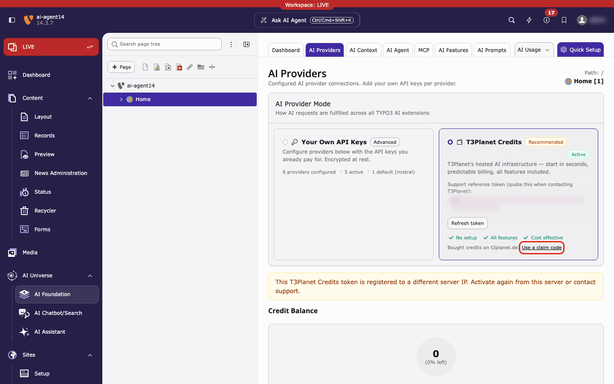

.. include:: ../../Includes.txt

.. _t3planet-credits-claim-code:

================
Use a claim code
================

The claim link is on :guilabel:`AI Foundation > AI Providers`: on the
:guilabel:`T3Planet Credits` card, click :guilabel:`Use a claim code` (red box).

   :guilabel:`AI Foundation > AI Providers`, :guilabel:`T3Planet Credits` card,
   link :guilabel:`Use a claim code` (red box). Here the yellow notice says that
   this site's token is not accepted, which is one reason to use a claim
   code.

A **claim code** connects your TYPO3 site to a T3Planet credits account that
already exists. T3Planet sends it to you by email. You paste it once. After
that the site uses your balance.

When do you need one?
=====================

* You **bought credits**, in the TYPO3 backend or on t3planet.de, and now want
  the site to use them.
* You are **recovering an account** after a site rebuild, a move to a new
  server, or a changed server IP address.
* TYPO3 says that **this server IP already belongs to a paying account** and
  asks you to use a claim code.

You do **not** need a claim code to start with the free trial. Use
:guilabel:`Activate` for that. See
:ref:`Configuration <t3planet-credits-configuration>`.

Where do you get the code?
==========================

* After **every purchase**, T3Planet emails the code to the address you used.
  This is the same if you bought in the TYPO3 backend (:guilabel:`AI Credit
  Bundles`) or on https://t3planet.de/ki-credits.
* Lost it, or it expired? Ask for a new one inside TYPO3 (see
  :ref:`below <t3planet-credits-claim-resend>`).

.. warning::

   Treat the code like a password. Anyone who has it can connect a site to
   your credits. Do not post it in tickets, chats or screenshots.

Enter the code
==============

1. Open :guilabel:`AI Foundation > AI Providers`. On the
   :guilabel:`T3Planet Credits` card, click :guilabel:`Use a claim code` (see
   the red box above).
2. Paste the code into :guilabel:`Claim code`. Spaces and line breaks are
   removed for you.
3. Click :guilabel:`Connect this site`.
4. A green message appears in the bottom right corner. Then the page reloads.

.. figure:: ../../Images/credits-claim-flow.gif
   :alt: Animated recording: the Use a claim code dialog, the pasted code (blurred), the green success message and the reloaded page with the credit balance
   :class: with-border with-shadow

   Steps 1 to 4 on a test site. The code and email are blurred.

What happens next
=================

* TYPO3 sends the code to T3Planet. The code is not stored in TYPO3.
* TYPO3 saves the access token it gets back in encrypted form and switches
  Credits on. You do not need to click :guilabel:`Activate`.
* After the reload, the :guilabel:`T3Planet Credits` card shows the green
  badge :guilabel:`Active`. :guilabel:`Credit Balance` shows your credits.
  See :ref:`Dashboard & AI Usage <t3planet-credits-ai-usage>`.

The green message depends on your site:

* *Your purchase was added to this site's existing credits account. Loading
  your dashboard…* The site already had a credits account, for example from
  the free trial. Your purchase is added to it. The balance can still say
  :guilabel:`Current: Free Trial`.
* *Credits account connected. Loading your dashboard…* The site had no credits
  account yet.

The :guilabel:`Use a claim code` link stays on the card after Credits is
active. If the code belongs to a different account than before, the list
:guilabel:`Recent AI Usage` is cleared. It then shows only the connected
account.

.. _t3planet-credits-claim-resend:

Lost the code or it expired
===========================

In the same dialog, use :guilabel:`Email me a code`.

1. Enter the email address of your T3Planet credits account.
2. Click :guilabel:`Email me a code`.
3. Paste the new code from the email.

T3Planet always answers *If that address has an AI Credits account, a claim
code is on its way to it.* It never says whether the address is registered.
The code goes only to the address stored on the account.

Code not accepted or something else does not work? See
:ref:`Troubleshooting: Claim code not accepted <t3planet-credits-troubleshooting-claim>`.
